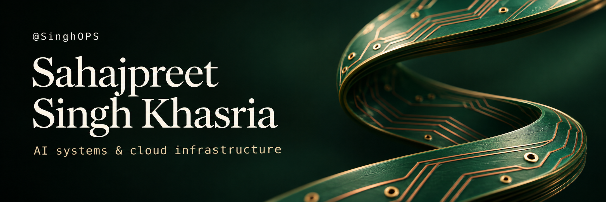

 <a href="#featured-work">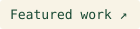</a> 

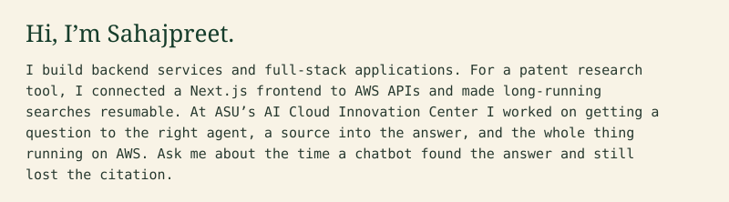

## Technology stack

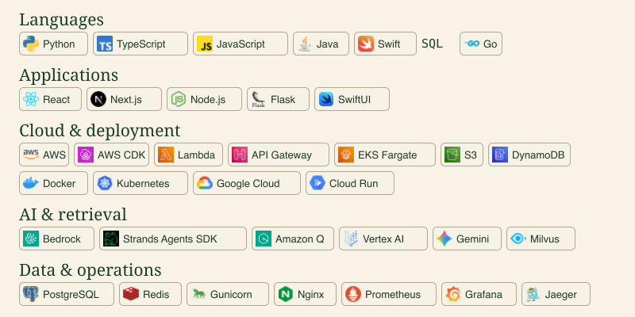

## Featured work

 <a href="https://github.com/ASUCICREPO/IECHO-RAG-CHATBOT/commit/eee2f173e37885c3e1cd0047af41467d31f0b367">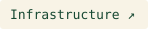</a>  <a href="https://github.com/ASUCICREPO/IECHO-RAG-CHATBOT/pull/5">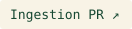</a> <a href="https://github.com/ASUCICREPO/IECHO-RAG-CHATBOT/pull/2">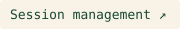</a>

 

  <a href="https://github.com/ASUCICREPO/crisis-help-chatbot/commit/608582b9c7caacad4fd37266e8bccc59ebad4f38">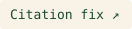</a> 

  

   

## Project directory

Multi-Agent Inference-Time Evaluation

Guardian — The Algorithmic Auditor

 <a href="https://github.com/SinghOPS/spark-challenge/commit/dbe1a7b03621b35eaeafb041835839333f1b6ba9">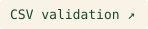</a>

TravelBuddy

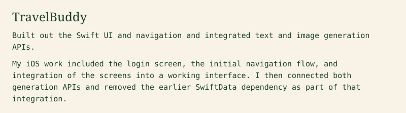

 <a href="https://github.com/SinghOPS/TravelBuddy/commit/dfea0184e3fd7540500ca96f30a667488ee7fc95">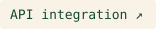</a>

PrepU

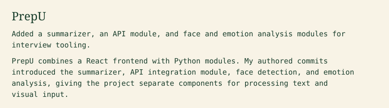

InterviewIQ

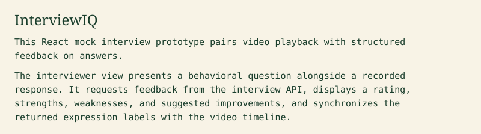

ASDA

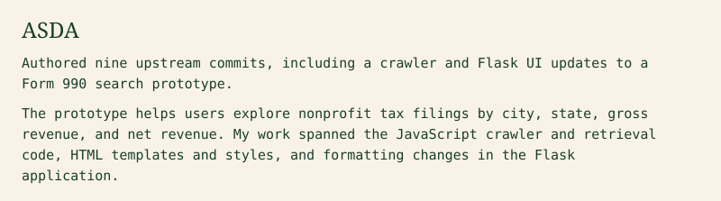

 

AWS AI Chatbot for Corrections

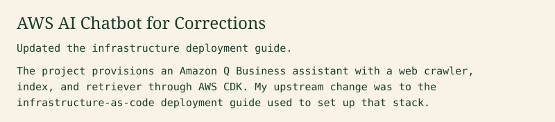

 <a href="https://github.com/ASUCICREPO/CIC-AI-Chatbot-Corrections/pull/2">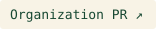</a>

